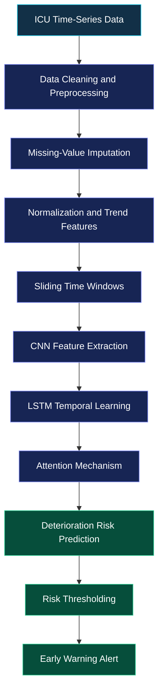

<div align="center">

# Early Warning System for Critical Patients

### AI-Inspired Clinical Deterioration Monitoring


<br>

A research-oriented project exploring early detection of clinical deterioration through patient vital signs, laboratory measurements, temporal trends, and deep learning concepts.

<br>

<a href="https://itspritamdas.github.io/early-warning-system-critical-patients/">
  
</a>
<a href="https://github.com/itsPritamDas/early-warning-system-critical-patients">
  
</a>

<br><br>


</div>

---

## Overview

The **Early Warning System for Critical Patients** explores how physiological time-series data can help identify patterns associated with potential clinical deterioration.

The project combines an interactive ICU-monitoring dashboard with a research-oriented deep learning workflow based on a proposed **CNN–LSTM architecture with temporal attention**.

The dashboard allows users to explore synthetic patient scenarios, monitor vital-sign trends, view an illustrative risk index, and understand how alerts could be presented in a clinical monitoring environment.

## Key Features

| Feature | Description |
|---|---|
| Patient Scenarios | Explore stable, sepsis-progression, and cardiac-event simulations |
| Vital Sign Monitoring | View heart rate, SpO₂, systolic blood pressure, respiratory rate, and other measurements |
| Risk Visualization | Display an illustrative deterioration-risk index |
| Interactive Trends | Explore changes in risk and selected physiological measurements over time |
| Alert History | Review simulated warning and critical events |
| Feature Contributions | Visualize illustrative contributions to the displayed risk score |
| Data Export | Export generated synthetic session data as CSV |
| Responsive Dashboard | Access the interface on desktop and mobile screens |
| Deep Learning Research | Explore the proposed CNN–LSTM with attention architecture |
| Model Development | Use the separate Python training pipeline as a starting point for experimentation |

## System Architecture

The proposed research workflow follows this sequence:



*This diagram represents the proposed research architecture, not a claim that the complete trained pipeline is currently deployed on the website.*

## Technologies Used

**Web Dashboard**
- HTML5
- CSS3
- Vanilla JavaScript
- SVG-based visualizations

**Machine Learning Research**
- Python
- PyTorch
- NumPy and pandas
- scikit-learn

## Getting Started

### 1. Clone the Repository

```bash
git clone https://github.com/itsPritamDas/early-warning-system-critical-patients.git
cd early-warning-system-critical-patients
```

### 2. Run the Dashboard

Keep the following files together in the same directory:

```text
index.html
styles.css
app.js
```

Open `index.html` in a modern browser.

Alternatively, run a local static server:

```bash
python -m http.server 8000
```

Then open:

```text
http://localhost:8000
```

The dashboard does not require a JavaScript build process.

### 3. Explore the Dashboard

1. Select a synthetic patient scenario.
2. Start or reset the simulation.
3. Observe the vital signs and risk visualization.
4. Explore trends and simulated alerts.
5. Export the generated session data when needed.

## Project Structure

```text
early-warning-system-critical-patients/
│
├── index.html
├── styles.css
├── app.js
├── README.md
│
└── ml/
    ├── README.md
    ├── model.py
    ├── prepare_data.py
    ├── train.py
    └── requirements.txt
```

## Research Methodology

The accompanying research report proposes the following methodology:

- **Data preprocessing:** Resampling, missing-value imputation, normalization, and physiological trend construction.
- **Time-series modeling:** Preparing sliding windows of patient observations.
- **CNN:** Extracting short-term patterns across physiological measurements.
- **LSTM:** Learning temporal dependencies in sequential observations.
- **Attention:** Assigning varying importance to time steps relevant to a prediction.
- **Risk estimation:** Producing a score that can be assessed against suitable warning thresholds.
- **Evaluation:** Comparing models using appropriate metrics and a carefully separated validation or test dataset.

## Important Research Limitation

The current GitHub Pages dashboard is a **simulation using synthetic data and a formula-based risk index**. It does not currently run trained CNN–LSTM model inference or connect to real patient records.

The Python machine learning code is a starting point for model development and experimentation. Reproducing the model results described in the report requires an appropriate dataset, documented preprocessing, patient-level data splitting, training, evaluation, and saved model weights.

This project is intended for academic and educational purposes only. Its synthetic risk scores are not clinical probabilities and must not be used to diagnose, treat, or make decisions about real patients.

## Future Scope

- Train and validate the proposed CNN–LSTM attention model.
- Evaluate AUROC, AUPRC, sensitivity, specificity, and prediction lead time.
- Investigate class imbalance and missing clinical observations.
- Improve temporal attention and feature-importance visualizations.
- Develop a backend API for model inference.
- Assess generalization across independent datasets.
- Explore calibrated alert thresholds and strategies for reducing false alarms.

## Contributors

- **Pritam Das**
- <div align="center">

# Early Warning System for Critical Patients

### AI-Inspired Clinical Deterioration Monitoring


<br>

A research-oriented project exploring early detection of clinical deterioration through patient vital signs, laboratory measurements, temporal trends, and deep learning concepts.

<br>

<a href="https://itspritamdas.github.io/early-warning-system-critical-patients/">
  
</a>
<a href="https://github.com/itsPritamDas/early-warning-system-critical-patients">
  
</a>

<br><br>


</div>

---

## Overview

The **Early Warning System for Critical Patients** explores how physiological time-series data can help identify patterns associated with potential clinical deterioration.

The project combines an interactive ICU-monitoring dashboard with a research-oriented deep learning workflow based on a proposed **CNN–LSTM architecture with temporal attention**.

The dashboard allows users to explore synthetic patient scenarios, monitor vital-sign trends, view an illustrative risk index, and understand how alerts could be presented in a clinical monitoring environment.

## Key Features

| Feature | Description |
|---|---|
| Patient Scenarios | Explore stable, sepsis-progression, and cardiac-event simulations |
| Vital Sign Monitoring | View heart rate, SpO₂, systolic blood pressure, respiratory rate, and other measurements |
| Risk Visualization | Display an illustrative deterioration-risk index |
| Interactive Trends | Explore changes in risk and selected physiological measurements over time |
| Alert History | Review simulated warning and critical events |
| Feature Contributions | Visualize illustrative contributions to the displayed risk score |
| Data Export | Export generated synthetic session data as CSV |
| Responsive Dashboard | Access the interface on desktop and mobile screens |
| Deep Learning Research | Explore the proposed CNN–LSTM with attention architecture |
| Model Development | Use the separate Python training pipeline as a starting point for experimentation |

## System Architecture

The proposed research workflow follows this sequence:


*This diagram represents the proposed research architecture, not a claim that the complete trained pipeline is currently deployed on the website.*

## Technologies Used

**Web Dashboard**
- HTML5
- CSS3
- Vanilla JavaScript
- SVG-based visualizations

**Machine Learning Research**
- Python
- PyTorch
- NumPy and pandas
- scikit-learn

## Getting Started

### 1. Clone the Repository

```bash
git clone https://github.com/itsPritamDas/early-warning-system-critical-patients.git
cd early-warning-system-critical-patients
```

### 2. Run the Dashboard

Keep the following files together in the same directory:

```text
index.html
styles.css
app.js
```

Open `index.html` in a modern browser.

Alternatively, run a local static server:

```bash
python -m http.server 8000
```

Then open:

```text
http://localhost:8000
```

The dashboard does not require a JavaScript build process.

### 3. Explore the Dashboard

1. Select a synthetic patient scenario.
2. Start or reset the simulation.
3. Observe the vital signs and risk visualization.
4. Explore trends and simulated alerts.
5. Export the generated session data when needed.

## Project Structure

```text
early-warning-system-critical-patients/
│
├── index.html
├── styles.css
├── app.js
├── README.md
│
└── ml/
    ├── README.md
    ├── model.py
    ├── prepare_data.py
    ├── train.py
    └── requirements.txt
```

## Research Methodology

The accompanying research report proposes the following methodology:

- **Data preprocessing:** Resampling, missing-value imputation, normalization, and physiological trend construction.
- **Time-series modeling:** Preparing sliding windows of patient observations.
- **CNN:** Extracting short-term patterns across physiological measurements.
- **LSTM:** Learning temporal dependencies in sequential observations.
- **Attention:** Assigning varying importance to time steps relevant to a prediction.
- **Risk estimation:** Producing a score that can be assessed against suitable warning thresholds.
- **Evaluation:** Comparing models using appropriate metrics and a carefully separated validation or test dataset.

## Important Research Limitation

The current GitHub Pages dashboard is a **simulation using synthetic data and a formula-based risk index**. It does not currently run trained CNN–LSTM model inference or connect to real patient records.

The Python machine learning code is a starting point for model development and experimentation. Reproducing the model results described in the report requires an appropriate dataset, documented preprocessing, patient-level data splitting, training, evaluation, and saved model weights.

This project is intended for academic and educational purposes only. Its synthetic risk scores are not clinical probabilities and must not be used to diagnose, treat, or make decisions about real patients.

## Future Scope

- Train and validate the proposed CNN–LSTM attention model.
- Evaluate AUROC, AUPRC, sensitivity, specificity, and prediction lead time.
- Investigate class imbalance and missing clinical observations.
- Improve temporal attention and feature-importance visualizations.
- Develop a backend API for model inference.
- Assess generalization across independent datasets.
- Explore calibrated alert thresholds and strategies for reducing false alarms.

## Contributors

- **Pritam Das**
- Rajib Roy
- Rahul Ghosh
- Pradyut Kumar De
- Pragya Das

Department of Computer Science and Engineering  
JIS University
